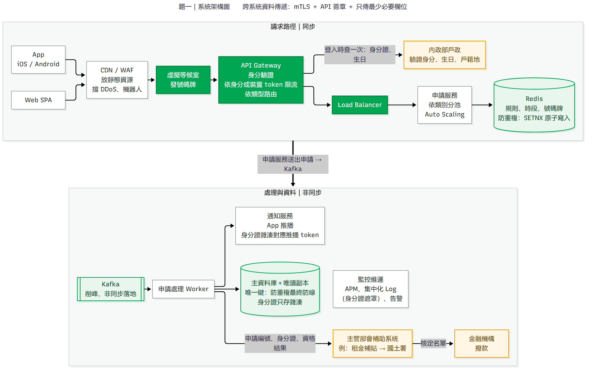

# SubsidySystem：全國補助線上申請平台

一道系統設計題的完整解答：政府把租金補貼、家電、旅遊、運動等多項補助整合成單一平台，提供 Web 與 App 兩種入口。專案包含三部分：

1. **使用者流程與系統架構**：高峰流量下如何排隊、分流，以及跨系統資料怎麼傳。
2. **SDLC 決策**：上線前 2 週規則臨時調整時，需求階段該產出什麼、怎麼取捨、出事後怎麼負責。
3. **實作**：受理資格驗證 API（Java / Spring Boot）、前端畫面 Wireframe、資料保存表。

整份設計圍繞三個原則：**流量會爆、規則會變、個資要保護**。



## 重點

- **資格驗證 API**：依序檢查類別、生日、身分證字號、年齡、開放時段、受理期間、本月是否已申請，任一項不通過就回傳對應的 `reasonCode`，以及下次可以申請的時間。共 74 個 JUnit 測試。
- **重複申請用原子寫入**：實測「先查詢再寫入」的做法，同一人同時送出 2 個請求，300 次試驗中 300 次都被重複受理，因此改為單一步驟寫入並判斷。
- **個資最小化**：資料庫只存身分證字號的雜湊值，log 只記遮罩後的字號（`A12****789`），API 用 POST 避免字號出現在 URL。資料保存表逐欄列出保存原因、保護方式與期限，並說明哪些資料刻意不存。
- **雜湊強度實測**：取得 salt 與 SHA-256 雜湊值後，筆電 CPU 用 33.9 秒就還原出身分證字號，所以正式環境要改用 HMAC-SHA256，金鑰放在 KMS。
- **時間邏輯可測試**：注入 `Clock`，每個請求只讀一次時間，時區固定為 `Asia/Taipei`。

## 快速開始

需要 Java 17 與 Maven。

```bash
cd subsidy-eligibility
mvn test              # 執行 74 個測試
mvn spring-boot:run   # 啟動，監聽 http://localhost:8080
```

```bash
curl -X POST http://localhost:8080/api/v1/subsidies/eligibility \
  -H "Content-Type: application/json" \
  -d '{"subsidyType":"SPORTS","birthDate":"1998-05-20","nationalId":"A123456789"}'
```

```json
{
  "eligible": false,
  "reasonCode": "OUT_OF_APPLICATION_PERIOD",
  "message": "此補助類別目前不在本月受理期間",
  "checkedAt": "2026-11-16T17:45:23+08:00",
  "nextAvailableAt": "2026-12-01T09:00:00+08:00"
}
```

API 使用真實時間，不同時間呼叫會得到不同結果。完整的 API 規格、驗證順序與設計假設見 [subsidy-eligibility/README.md](subsidy-eligibility/README.md)。

## 專案結構

```
.
├── subsidy-eligibility/     # 受理資格驗證 API（Java 17、Spring Boot 3.5、JUnit 5）
└── deliverables/            # 設計文件與簡報素材
    ├── 01-user-flow         # 使用者流程圖（Mermaid 原始檔 + PNG）
    ├── 02-architecture      # 系統架構圖
    ├── 03-frontend-flow     # 前端程式流程圖
    ├── 04-wireframes        # 6 個前端畫面（HTML 原始檔 + PNG）
    ├── 05-data-dictionary   # 資料保存表與不保存的資料
    ├── 06-sdlc-notes        # SDLC 決策：需求階段（主）、上線維運（備案）
    ├── 07-presentation-draft # 簡報逐頁草稿
    ├── 08-presentation.pptx # 簡報（封面 + 主講 10 頁 + 附錄 14 頁）
    ├── 09-speech-script     # 5 分鐘講稿
    ├── code-screenshots/    # 程式碼截圖產生腳本
    └── presentation/        # 簡報產生腳本（PptxGenJS）
```

## 文件導覽

| 想看 | 檔案 |
|---|---|
| 使用者從進站到拿到結果的流程 | [01-user-flow.png](deliverables/01-user-flow.png) |
| 系統元件與跨系統資料流 | [02-architecture.png](deliverables/02-architecture.png) |
| 申請表單、錯誤提示、排隊、結果畫面 | [04-wireframes.html](deliverables/04-wireframes.html) |
| 每個欄位為什麼存、怎麼保護、存多久 | [05-data-dictionary.md](deliverables/05-data-dictionary.md) |
| 規則上線前臨時調整時的處理方式 | [06-sdlc-notes.md](deliverables/06-sdlc-notes.md) |
| 整體提案 | [08-presentation.pptx](deliverables/08-presentation.pptx) |

## 重新產生圖片與簡報

圖表、截圖與簡報都由原始檔產生，修改後可重新輸出：

- 流程圖與架構圖：以 [Mermaid CLI](https://github.com/mermaid-js/mermaid-cli) 轉換 `.mmd` 檔。
- 程式碼截圖：見 [deliverables/code-screenshots/README.md](deliverables/code-screenshots/README.md)。
- 簡報：在 `deliverables/presentation/` 執行 `npm install` 後執行 `node build-deck.cjs`。這會覆蓋 `08-presentation.pptx`，在 PowerPoint 裡做的手動修改不會保留。
