# 簡報草稿：全國補助線上申請平台

- 用途：先交主管書面審閱；通過後，同一份簡報用於口頭報告（不超過 5 分鐘）。
- 寫法：主管審閱時聽不到口頭說明，所以每頁標題直接寫結論，重點寫在投影片上。題目要求每題都要談的「跨系統資料傳遞」與「個資」，放在各題頁面底部的【跨系統】【個資】欄。
- 結構：封面＋主講 10 頁＋附錄 14 頁（目錄＋A1–A7）。簡報檔為 [08-presentation.pptx](08-presentation.pptx)，由 [presentation/build-deck.cjs](presentation/build-deck.cjs) 產生，文字以該腳本為準。全場講稿見 [09-speech-script.md](09-speech-script.md)：合計 915 單位（中文一字 1、英文詞 2），以每分鐘 200 單位估算約 4 分 35 秒。
- 圖片路徑相對於 `deliverables/`。

## 頁面總覽

| 頁 | 標題 | 圖片 | 口說 |
|---|---|---|---|
| 封面 | 全國補助線上申請平台：系統設計與優化提案 | 無 | 不講 |
| 1 | 問題定義：三個設計原則 | 無 | 64 單位 |
| 2 | 題一：使用者流程 | `01-user-flow.png` | 125 單位 |
| 3 | 題一：系統架構 | `02-architecture.png` | 126 單位 |
| 4 | 題二：產出與取捨 | 無 | 138 單位 |
| 5 | 題二：出事後負責 | 無 | 66 單位 |
| 6 | 題三：後端 API | `code-screenshots/eligibility-service.png` | 129 單位 |
| 7a | 題三：前端程式流程 | `03-frontend-flow.png` | 41 單位 |
| 7b | 題三：前端畫面 | `04-wireframe-1/2/4/5/6-slide.png` | 70 單位 |
| 8 | 題三：資料保存 | 無 | 91 單位 |
| 9 | 結語：兩個實測 | 無 | 65 單位 |
| A1–A7 | 附錄（14 頁） | 見各頁 | 不講 |

---

## 封面

- 主標：全國補助線上申請平台：系統設計與優化提案
- 副標：系統設計作品
- 姓名：劉姮妤
- 版面：純文字，不放 logo 或商標。

---

## 第 1 頁｜問題定義

**標題：三個設計原則貫穿三道題：流量會爆、規則會變、個資要保護**

投影片內容：

> 多項補助整合為單一平台，提供 Web 與 App 兩種入口；租金補貼 300 億、上看 75 萬戶（題目提供數據）。

| 原則 | 來源 | 對應設計 |
|---|---|---|
| 流量會爆 | 設計：排隊與擴縮預算受限<br>測試：高峰流量難重現<br>上線：開跑當天流量暴增 | 未開放就先擋下、不必排隊；開放後依類型與負載分流，超量進虛擬等候室 |
| 規則會變 | 需求：上線前 2 週改規則，跨部會意見不一致 | 規則集中成資料、74 個自動化測試；Feature Flag 切換新舊規則（設計） |
| 個資要保護 | 題目要求：每題都要談跨系統與個資 | 只存身分證雜湊、log 遮罩；跨系統只傳必要欄位並加密 |

頁尾小字：題目要求逐項對照見附錄 A1。

講稿：見 [09-speech-script.md](09-speech-script.md) 第 1 頁（64 單位，約 19 秒）。

---

## 第 2 頁｜題一：使用者流程

**標題：未開放就先擋下；開放後依類型和負載分流；4 種錯誤各有出口**

圖片（滿版寬度，放標題下方）：

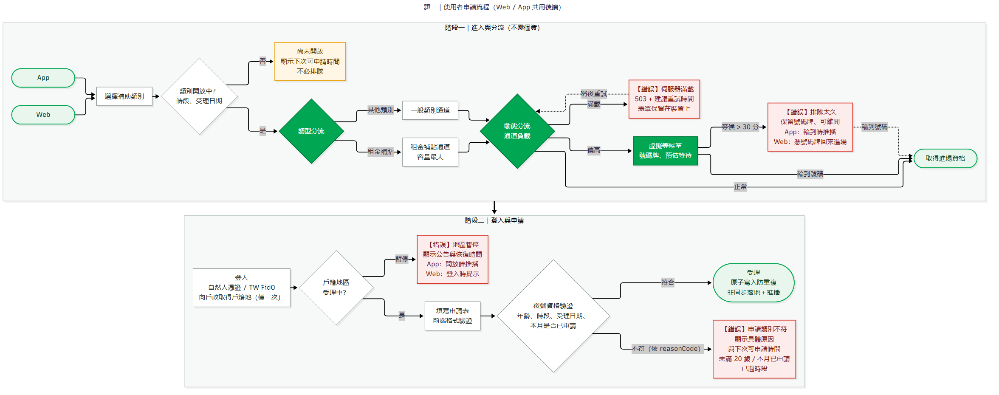

圖下三欄文字：

| 分流策略（3 種） | 錯誤處理（題目要求 4 種） | Web 與 App |
|---|---|---|
| 類型分流（租金補貼獨立通道）、動態分流（依通道負載）、虛擬等候室（號碼牌） | 排隊太久、伺服器滿載、申請類別不符、地區暫停，每種都告知下一步 | 共用後端與流程，只差在通知：App 推播；Web 憑號碼牌回來或登入時提示 |

頁尾：
- 【跨系統】登入時向內政部戶政取得戶籍地，只查一次，供地區分流使用。
- 【個資】登入前的階段一（選類別、分流、排隊）不需輸入個資。

講稿：見 [09-speech-script.md](09-speech-script.md) 第 2 頁（125 單位，約 38 秒）。

---

## 第 3 頁｜題一：系統架構

**標題：尖峰擋在 Gateway 之前；同步只做判斷，寫入交給佇列；防重複有兩道關卡**

圖片（左側約 65% 寬）：

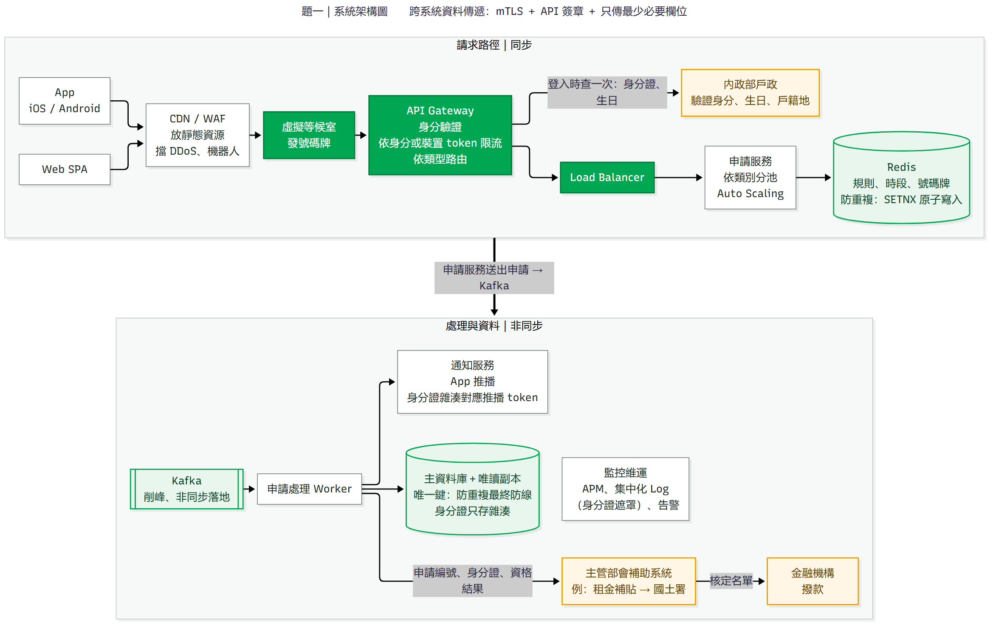

右側文字：
- 邊緣層：CDN/WAF 擋機器人；虛擬等候室在這一層發號碼牌。
- 限流：依登入身分或裝置 token，登入前（選類別、排隊）用裝置 token。不依 IP：行動網路大量使用者共用同一個 IP，會誤擋。
- 同步與非同步：申請服務判斷資格、寫入 Redis 後即回應；Kafka 削峰，Worker 再寫 DB、傳主管部會。
- 防重複：Redis SETNX 原子寫入擋第一道，DB 唯一鍵最後把關

頁尾：
- 【跨系統】戶政（驗證身分）、主管部會（核定）、金融機構（撥款）一律 mTLS ＋ API 簽章，只傳最少必要欄位。
- 【個資】DB 只存身分證雜湊；log 集中化前先遮罩身分證字號。

講稿：見 [09-speech-script.md](09-speech-script.md) 第 3 頁（126 單位，約 38 秒）。

---

## 第 4 頁｜題二：產出與取捨（需求階段）

**標題：需求階段：規則以簽核文件為準，凍結期只接受參數變更**

投影片內容：

> 情境（假設）：上線前 2 週，國土署要求租金補貼受理日由每月 1–10 日延長到 1–15 日；另一部會認為會排擠其他補助的尖峰容量而反對；高層要求如期上線。

**一、必須產出的文件與原因**

| 產出 | 為什麼必須有 |
|---|---|
| 補助規則規格書（參數值、生效日、決策部會、簽核人） | 意見不一致時以書面簽核為準，不接受口頭變更；出事時查得到誰、何時決定 |
| 需求追溯表（規則 → 程式參數 → 測試案例） | 規則一改，立刻知道要改哪個參數、重跑哪些測試 |
| 跨系統介面規格 | 規則若要多傳欄位，會連動戶政、主管部會、金融機構 |
| 個資衝擊評估 | 規則若要多蒐集個資，告知文字與保存方式都要跟著改 |

**二、理想做不到時的取捨**
- 理想：規則凍結後才開發，改了就完整重測；上線前 2 週做不到。
- 決策：凍結期只接受參數變更（日期、年齡、時段）。簽核前照原規則上線，新規則放在 Feature Flag（設計）後面，簽核後再開。
- 題三程式：受理日期寫成資料，集中在 `SubsidyType` 一處，改規則只動一行；改完跑 74 個測試，幾秒內知道有沒有改壞。目前改參數仍要重新部署，正式環境移到設定檔後就不用。
- 延後：需要新欄位、多傳或多蒐集個資的變更，延到下一版。

頁尾：
- 【跨系統】產出介面規格；要多傳欄位給其他系統的變更，延到下一版。
- 【個資】產出個資衝擊評估；要多蒐集個資的變更，延到下一版。

講稿：見 [09-speech-script.md](09-speech-script.md) 第 4 頁（138 單位，約 41 秒）。

---

## 第 5 頁｜題二：出事後負責

**標題：參數設錯由我負責：分鐘級切回、用雜湊找出受影響的人、30 分鐘內第一報**

投影片內容：

> 事件（假設）：新規則簽核通過、旗標開啟，但參數誤設為 1–5 日（應為 1–15 日），6 日起的申請人被誤判為「不在受理期間」。

| 負責 | 補救 | 向上說明 |
|---|---|---|
| 「凍結期接受參數變更」是我的決策，由我負責。先止血，不先追究誰輸錯。 | 1. 切回旗標，恢復舊規則 1–10 日（設計上為執行期切換，不必重新部署）<br>2. 修正參數為 1–15 日，覆核後重新開啟旗標<br>3. 用稽核 log 的原因代碼、時間、身分證雜湊，撈出受影響的人<br>4. App 推播通知；Web 使用者登入時提示，並發布公告 | 30 分鐘內第一報：影響人數、時段、已採取措施<br>事後根因報告：參數只有一人輸入、沒有覆核；改為雙人覆核，自動化測試設為上線前必要關卡 |

頁面底部一行：改善後的規則變更：簽核、改參數、雙人覆核、跑 74 個測試、開旗標。

頁尾：
- 【個資】用稽核 log 的身分證雜湊比對受影響名單，不需為了通知另外保存電話或 Email。

講稿：見 [09-speech-script.md](09-speech-script.md) 第 5 頁（66 單位，約 20 秒）。

---

## 第 6 頁｜題三：後端 API

**標題：後端 API：輸入 3 個 String，7 道檢查依序執行，回傳 Boolean 與原因代碼**

圖片（左側約 60% 寬）：

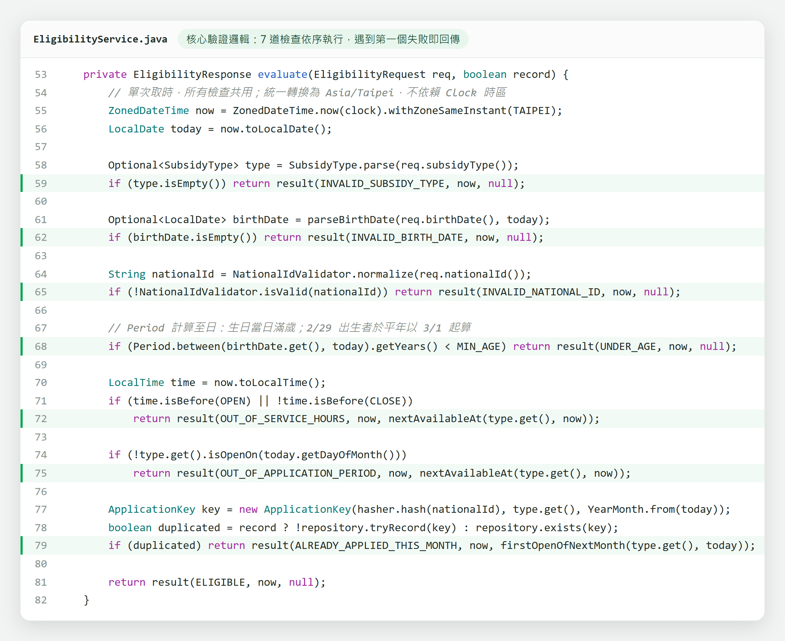

右側文字：

- 兩支 API
  - `POST /api/v1/subsidies/eligibility`：資格查詢，只讀
  - `POST /api/v1/subsidies/applications`：送件，檢查通過後原子寫入
- 回應範例（租金補貼，11/16 19:02 查詢；`eligible` 即題目要求的 Boolean）

  ```json
  {
    "eligible": false,
    "reasonCode": "OUT_OF_SERVICE_HOURS",
    "nextAvailableAt": "2026-12-01T09:00:00+08:00"
  }
  ```
- 檢查順序（左圖綠底各行），遇到第一個失敗即回傳：1 類別、2 生日、3 身分證格式與檢查碼、4 年滿 20 歲、5 每日 09:00–18:00、6 各類別受理日、7 本月是否已受理
- 測試：JUnit 5 共 74 個，全部通過：時段與受理日邊界、2/29 出生；32 條執行緒同時寫入同一鍵，200 輪都只有 1 筆成功。

頁尾：
- 【個資】用 POST 不用 GET，身分證字號不會出現在 URL 和 access log；log 只記遮罩值 `A12****789`；JSON 格式錯誤時不記錄原始內容。
- 【附錄】Controller、Request、Response 原始碼見附錄 A3。

講稿：見 [09-speech-script.md](09-speech-script.md) 第 6 頁（129 單位，約 39 秒）。

---

## 第 7a 頁｜題三：前端程式流程（App）

**標題：前端（App）：格式錯誤在送出前攔下；送出後依 HTTP 狀態與原因代碼分流**

圖片（滿版寬度）：

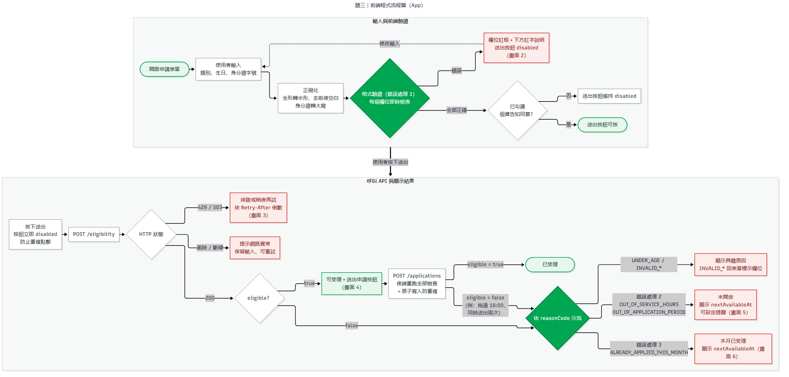

圖下文字：
- 送出前：先正規化（全形轉半形、去前後空白、轉大寫），再逐欄即時驗證格式；勾選個資同意後才能送出。
- 送出後：429/503 進排隊畫面；逾時保留輸入、可重試；200 依 `eligible` 與原因代碼顯示對應畫面。

講稿：見 [09-speech-script.md](09-speech-script.md) 第 7a 頁（41 單位，約 12 秒）。

---

## 第 7b 頁｜題三：前端畫面

**標題：從查詢到結果的 5 個畫面；題目要求的 3 種錯誤各對應一個畫面**

圖片（5 支手機並排）：

<p>
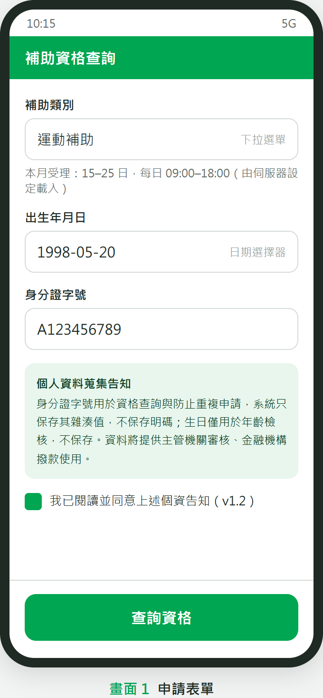
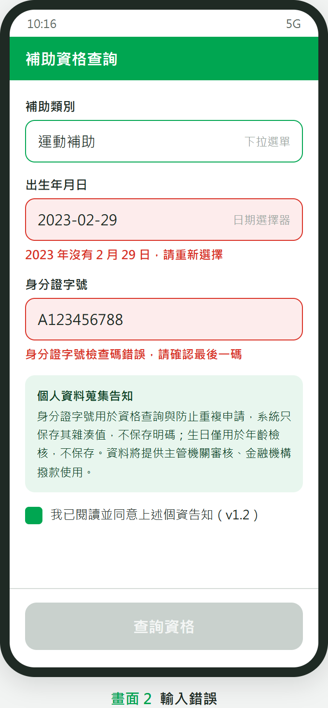
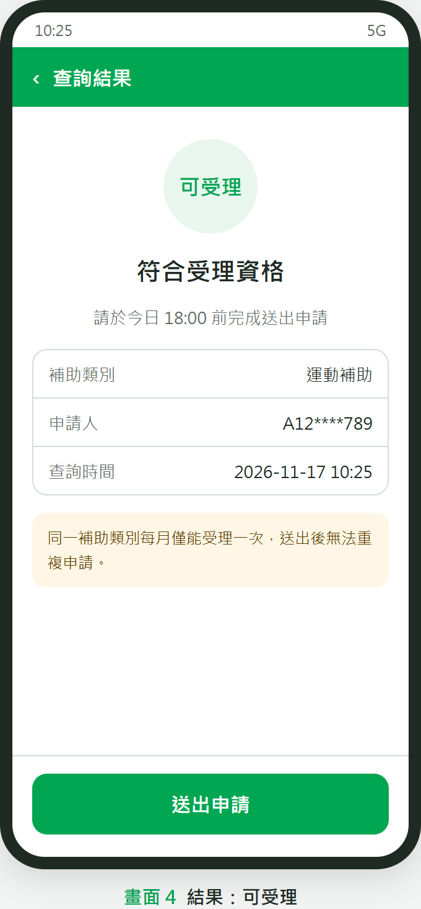
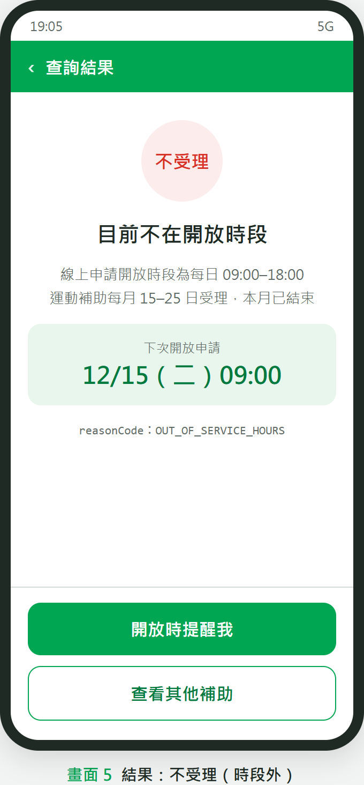
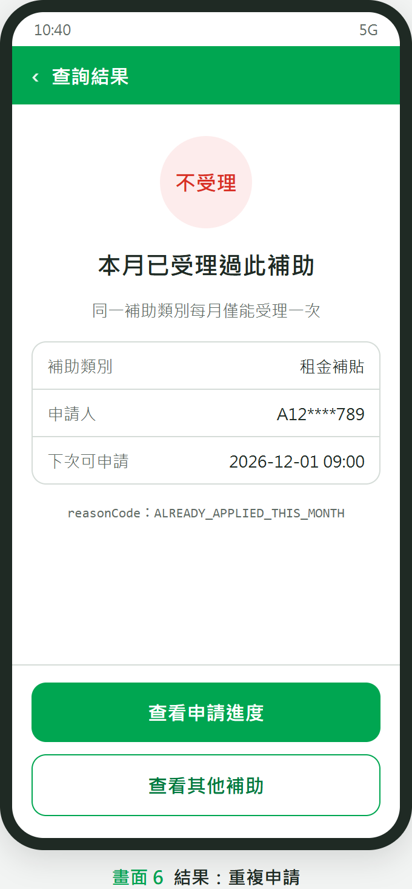
</p>

每支手機下方的說明：

| 畫面 | 說明 |
|---|---|
| 1 申請表單 | 個資告知寫明資料用途與利用對象，勾選同意才能送出 |
| 2 錯誤處理 1｜格式驗證 | 紅框加紅字說明原因，送出按鈕停用 |
| 4 可受理 | 身分證只顯示遮罩值；按「送出申請」才寫入，後端重跑全部檢查 |
| 5 錯誤處理 2｜開放時段 | 11/26 19:05 查詢，下次開放 12/15 09:00：同時考慮時段與受理日期 |
| 6 錯誤處理 3｜當月已受理 | 唯一鍵（身分證雜湊、類別、年月）；送件時原子寫入，DB 唯一鍵為最終防線 |

頁尾：
- 【跨系統】畫面 1 告知資料將提供主管機關審核、金融機構撥款。
- 【個資】畫面只顯示遮罩後的身分證字號；生日只用於年齡檢核，不保存。

講稿：見 [09-speech-script.md](09-speech-script.md) 第 7b 頁（70 單位，約 21 秒）。

---

## 第 8 頁｜題三：資料保存

**標題：只存判斷資格、防重複、處理客訴所需的最少欄位；身分證只存雜湊，生日不存**

投影片內容：

| 資料 | 為什麼要存 | 個資 | 保護方式 | 保存期限 |
|---|---|---|---|---|
| 身分證雜湊 | 防重複的唯一鍵；客訴時查此人紀錄 | 是（假名化） | 正規化後雜湊；正式環境改 HMAC，金鑰放 KMS | 核撥後 5 年（假設） |
| 補助類別、申請年月 | 唯一鍵其餘兩欄；「每月一次」依年月判斷 | 否 | — | 同上 |
| 受理時間、來源管道、地區 | 客訴舉證；比較 Web 與 App 效能；地區分流 | 間接 | 時間由伺服器寫入；地區只存縣市 | 同上 |
| 稽核 log（原因代碼、遮罩身分證） | 說明為何不受理；異常分析 | 是（部分） | 遮罩；不存原始輸入 | 1 年（假設） |
| 申請編號 | 客服查詢與跨系統對帳，不拿身分證當對外識別碼 | 否 | 隨機產生 | 核撥後 5 年（假設） |

刻意不保存（個資法第 5 條：不得逾越特定目的之必要範圍）
- 身分證明碼：雜湊就能判斷是否同一人；明碼不寫入任何資料表，只在傳送途中加密暫存
- 出生年月日：判斷完只留結果。
- 姓名、地址、電話、Email：資格判斷用不到；通知改用 App 推播與 Web 登入時提示。
- API 請求原始內容：內含身分證與生日。

頁尾：
- 【跨系統】Worker 把身分證明碼加密傳給主管部會核定撥款；明碼只在 Kafka 加密保留 7 天（假設），不寫入任何資料表。
- 【個資】完整欄位表見附錄 A5；期限屆滿依個資法第 11 條刪除。

講稿：見 [09-speech-script.md](09-speech-script.md) 第 8 頁（91 單位，約 27 秒）。

---

## 第 9 頁｜結語

**標題：兩個本機實測改變了設計**

投影片內容（兩張大數字卡片並排）：

| 300 / 300 | 33.9 秒 |
|---|---|
| 先查詢再寫入，兩步之間隔 1 ms，同一人同時送出 2 個請求：300 次試驗全部被重複受理 | 取得 salt 與雜湊值後，筆電 CPU 還原出身分證字號；全台約 5.2 億個合法字號，最多 2.9 分鐘試完 |
| 改為：原子寫入 ＋ DB 唯一鍵 | 改為：正式環境用 HMAC，金鑰放 KMS 與 DB 分開保管 |

註記小字：數據為本機實測。

講稿：見 [09-speech-script.md](09-speech-script.md) 第 9 頁（65 單位，約 20 秒）。

---

## 附錄（不講，供審閱與追問）

### A1｜題目要求對照表

| 題目要求 | 對應頁面 |
|---|---|
| 題一：使用者流程，Web 與 App 都要畫 | 第 2 頁（兩個入口；通知方式不同） |
| 題一：分流策略至少 2 種 | 第 2 頁（類型分流、動態分流、排隊機制） |
| 題一：排隊太久、伺服器滿載、申請類別不符、地區暫停 | 第 2 頁 |
| 題一：架構圖含 API Gateway、Load Balancer、後端、DB、Cache、Queue | 第 3 頁 |
| 題二：產出文件與必要性 | 第 4 頁 |
| 題二：理想做不到時如何取捨 | 第 4 頁 |
| 題二：上線後出問題如何負責、補救、向上說明 | 第 5 頁 |
| 題三：Java 後端、關鍵程式碼截圖 | 第 6 頁、附錄 A3 |
| 題三：輸入 3 個 String、輸出 Boolean | 第 6 頁 |
| 題三：年滿 20 歲、09:00–18:00、各類別受理日 | 第 6 頁（檢查 4、5、6） |
| 題三：前端擇一（App），從查詢到結果 | 第 7a、7b 頁 |
| 題三：程式流程圖 | 第 7a 頁 |
| 題三：輸入格式驗證、開放時段、重複申請 | 第 7b 頁（畫面 2、5、6） |
| 題三：保存哪些資料、為什麼 | 第 8 頁、附錄 A5 |
| 每題都談跨系統資料傳遞 | 題一第 2、3 頁；題二第 4 頁；題三第 7b、8 頁 |
| 每題都談個資 | 題一第 2、3 頁；題二第 4、5 頁；題三第 6、7b、8 頁 |

### A2｜實驗驗證：8 項實測，各改了一個設計決定

| 驗證項目 | 實測結果 | 設計決定 |
|---|---|---|
| 生日解析 | `ofPattern("yyyy-MM-dd")` 把 `2023-02-29` 默默改成 `2023-02-28` | 改用 `LocalDate.parse` 嚴格解析 |
| 去除空白 | `trim()` 去不掉中文輸入法的全形空白 | 改用 `strip()` |
| 格式比對 | `find()` 讓尾端帶換行的輸入通過 | 改用 `matches()` |
| 欄位型別 | DTO 用 enum 或 `LocalDate` 時，錯誤格式在反序列化就回 400，原因代碼 1、2 永遠不出現 | DTO 欄位全部用 String，由 Service 驗證 |
| 錯誤訊息 | Jackson 例外訊息帶出原始輸入，包含身分證與生日 | 統一處理 JSON 錯誤，不記錄例外訊息 |
| 遮罩 | `substring` 寫法遇到 `"A12"` 拋例外 | 遮罩可處理任意輸入 |
| 重複申請 | 先查後寫，300 次試驗 300 次重複受理 | 原子寫入 |
| 雜湊還原 | 33.9 秒還原身分證字號 | 正式環境改 HMAC |

### A3｜程式碼截圖原尺寸

API 入口（Boolean 產生位置：`EligibilityResponse` 第 24 行）：

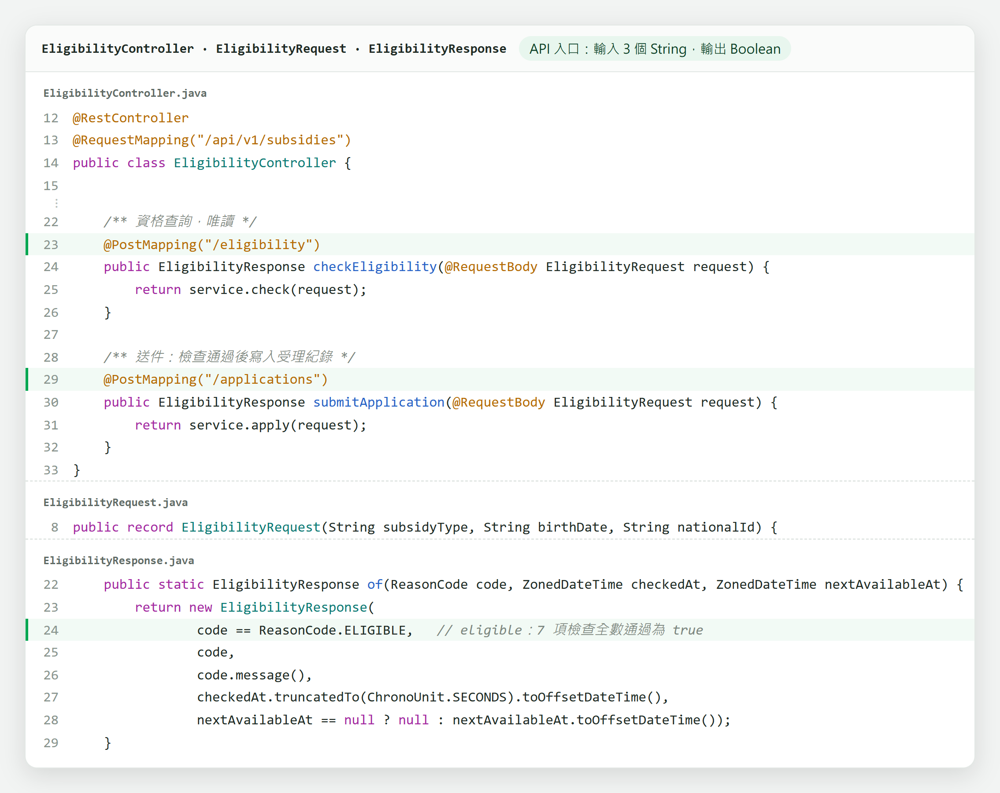

身分證字號驗證（正規化、格式、檢查碼）：

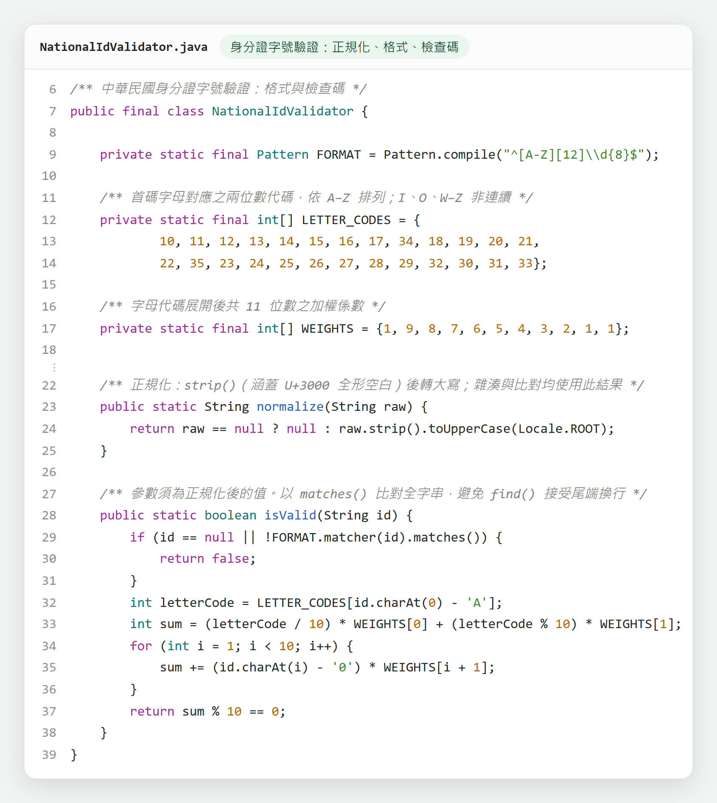

### A4｜6 個畫面完整版（含畫面 3 排隊等候與各畫面說明）

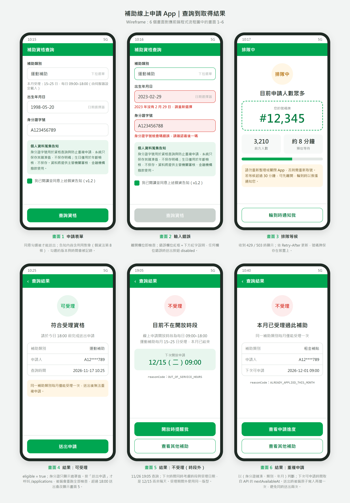

### A5｜完整資料保存表

內容取自 [05-data-dictionary.md](05-data-dictionary.md)，分四頁：
- A5-1：受理紀錄（8 欄）
- A5-2：稽核 log（7 欄）
- A5-3：處理中的暫存資料、通知服務
- A5-4：刻意不保存的資料

### A6｜題二備案：上線維運

內容取自 [06-sdlc-notes.md](06-sdlc-notes.md)「備案：上線維運」表格。簡報版的「取捨」改寫為：真實高峰流量無法完全重現，所以用虛擬等候室限流，超過容量的人先排隊，保住系統。跨系統呼叫（戶政、主管部會）設逾時與降級，對方變慢時不拖垮本系統。

### A7｜設計假設與正式環境考量

內容取自 [subsidy-eligibility/README.md](../subsidy-eligibility/README.md)：
- 設計假設：時區、18:00 整不受理、受理日兩端都包含、生日當天滿 20 歲、2/29 出生以 3/1 起算、類別大小寫、全形空白、null 處理、重複申請唯一鍵、新式居留證未支援。
- 簡報素材的假設：排隊超過 30 分鐘視為太久、登入方式與戶籍地查詢、資料保存期限、題二情境、Feature Flag 只有設計未實作。
- 正式環境考量（標題：本實作未做的 5 項）：受理紀錄改 DB 唯一鍵、雜湊改 HMAC＋KMS、先登入再查詢（身分證從憑證取得）、生日向戶政驗證、類別放入路徑供 Gateway 路由。
